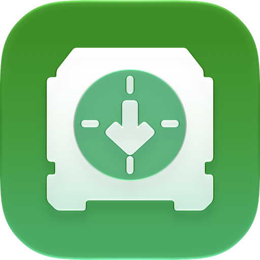

# TangoDown

Keep every shot.

TangoDown saves your XBOX screenshots and game clips to your Mac before XBOX network deletes them, then backs them up to iCloud Drive, Google Drive, Dropbox, a NAS or WebDAV.

**[Website](https://fm-43.github.io/tangodown/)** · **[Download](https://github.com/fm-43/tangodown/releases/latest)** · macOS 26 or later

## Opening TangoDown the first time

TangoDown isn’t notarized by Apple, so macOS asks you to confirm it once.

1. Move TangoDown to your Applications folder and double-click it. When macOS says it couldn’t verify TangoDown, click Done.
2. Open System Settings › Privacy & Security. Under Security, next to the message about TangoDown, click Open Anyway, then confirm.

After that, TangoDown opens like any other app. Do the same after installing a new version.

## Privacy

No TangoDown account, no TangoDown servers. Captures go from XBOX to your Mac to your destinations, and every sign-in is sealed by your Mac’s Secure Enclave.

---

This repository holds TangoDown’s website and its releases.
